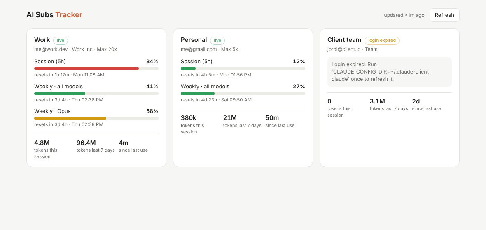

# AI Subs Tracker

One place to see how much of each AI coding subscription you have left.

The MVP covers **Claude Code**. Track any number of Claude subscriptions (work Max, personal Pro, a client's Team seat…) side by side, in your terminal or in a local dashboard. It runs anywhere Node 20+ runs: macOS, Linux and Windows.



For each account it shows:

| | Source | Needs network |
|---|---|---|
| **Plan limits**: 5-hour session %, weekly %, weekly Opus/Sonnet %, reset times, extra-usage credits | Same endpoint Claude Code's `/usage` screen uses | yes |
| **Who it is**: email, org, plan (Pro / Max 5x / Max 20x / Team) | Claude Code's local state files | no |
| **Local activity**: tokens this session, last 7 days, time since last use | Claude Code's transcript logs (`projects/**/*.jsonl`) | no |

## Quick start

```bash
git clone https://github.com/JordiParraCrespo/ai-subs-tracker
cd ai-subs-tracker
npm install && npm run build && npm link   # installs the `aisubs` command

aisubs              # terminal summary of every account
aisubs serve --open # dashboard at http://127.0.0.1:4317
```

With no config, `aisubs` auto-discovers `~/.claude` and any `~/.claude-*` directories. To keep them (and rename them):

```bash
aisubs discover --save
aisubs accounts list
```

## Several Claude subscriptions

Claude Code keeps one login per **config directory**. Give each subscription its own directory via `CLAUDE_CONFIG_DIR` and log in once:

```bash
CLAUDE_CONFIG_DIR=~/.claude-work claude      # then /login with the work account
CLAUDE_CONFIG_DIR=~/.claude-personal claude  # then /login with the personal account
```

Tip: shell aliases make this painless, e.g. `alias claude-work='CLAUDE_CONFIG_DIR=~/.claude-work claude'`.

Then track them:

```bash
aisubs accounts add --label "Work" --config-dir ~/.claude-work
aisubs accounts add --label "Personal" --config-dir ~/.claude-personal
aisubs accounts remove personal
```

Accounts are stored in `accounts.json` in:

| OS | Location |
|---|---|
| macOS | `~/Library/Application Support/ai-subs-tracker/` |
| Linux | `$XDG_CONFIG_HOME/ai-subs-tracker/` (default `~/.config/…`) |
| Windows | `%APPDATA%\ai-subs-tracker\` |

Set `AISUBS_CONFIG_DIR` to use a different location.

```json
{
  "version": 1,
  "accounts": [
    { "id": "work", "label": "Work", "provider": "claude-code", "configDir": "~/.claude-work" }
  ]
}
```

## Commands

```
aisubs [status] [--json]            Usage for every account (exit code 2 if any needs attention)
aisubs serve [--port 4317] [--host 127.0.0.1] [--open]
aisubs discover [--save]
aisubs accounts list | add | remove
```

`aisubs status --json` returns the full snapshot, so you can feed it to a status bar (SwiftBar/xbar, Waybar, tmux, …).

## How it gets the data (and what it never does)

- **Credentials are read-only.** On Linux and Windows the login comes from `<configDir>/.credentials.json`. On macOS it comes from the Keychain item Claude Code created (`Claude Code-credentials`, plus a hash suffix for a custom `CLAUDE_CONFIG_DIR`). macOS may ask you once to allow access. If auto-detection picks the wrong item, set `keychainService` on the account.
- **Tokens are never refreshed.** Claude Code's refresh tokens rotate, so refreshing them here would silently log Claude Code out. When a login expires, the dashboard says so and tells you which `claude` command to run once to refresh it.
- **Nothing leaves your machine** except the usage request to `api.anthropic.com`, sent with that account's own token. The dashboard binds to `127.0.0.1` only.
- **Rate-limit friendly.** Results are cached for 60 s and manual refreshes are limited to one every 15 s, however many tabs are open.

> ⚠️ The usage endpoint is the one Claude Code itself uses. Anthropic doesn't document it as a public API, so it may change. Parsing is tolerant: windows it doesn't recognise still show up with a generated label.

## Development

```bash
npm install
npm test          # node:test, no network: fake home dirs + fake API
npm run dev       # build + open the dashboard
```

```
src/
  cli.ts                     aisubs command
  collect.ts                 resolve accounts → snapshots (provider-agnostic)
  config.ts                  per-OS config file
  types.ts                   Provider / AccountSnapshot contracts
  providers/claude-code/     credentials, usage API, local logs, discovery
  server/                    local HTTP server + self-contained dashboard page
```

### Adding a provider

Implement `Provider` from `src/types.ts` (`snapshot()`, optionally `discover()`), then register it in `src/providers/index.ts`. The CLI and dashboard render any provider's `AccountSnapshot` without changes.

## Roadmap

1. **Codex.** `~/.codex/auth.json` plus the `rate_limits` (primary/secondary window %) that Codex writes into its session logs.
2. **Menu-bar / tray app** for macOS, Windows and Linux: a thin Tauri or Electron shell around the existing dashboard, with the current session % in the menu bar.
3. **Alerts** at e.g. 80% of the 5-hour window, and a "best account to use right now" hint.
4. **Hosted sync (optional)**: sign in once and see every machine's accounts in one place. A small agent on each machine would push snapshots, never credentials.
5. More providers: Cursor, Gemini CLI, GitHub Copilot.
